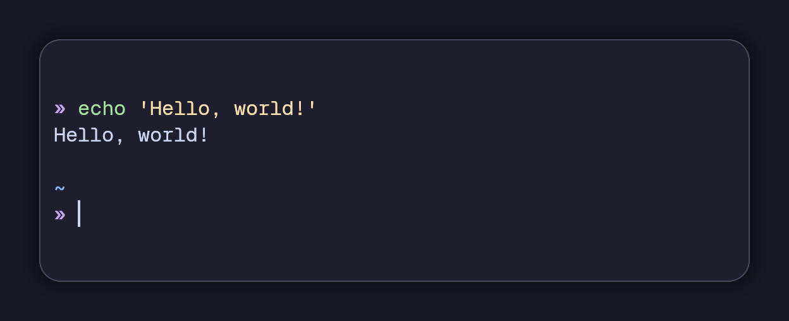

<p align="center">
  
</p>

# Zing
*is a performant, opinionated zsh configuration for Nix.*

## Try it

On any Nix machine, you can run:

```sh
nix run github:jameschubbuck/Zing
```

You do need flakes enabled, though.

## Install

To install permanently, add the following to your configuration just like any other input:

```nix
# flake.nix

inputs.zing.url = "github:jameschubbuck/Zing";

# any home-manager module

{inputs, ...}: {
  imports = [inputs.zing.homeModules.default];
  programs.zing.enable = true;
}
```

## Features

### Performance

Zing is about 4x faster than oh-my-zsh, though still 3x slower than stock zsh. In practice, the difference from stock zsh is under 10 ms, which is generally trivial.

Speed is derived from many optimizations. To name a few:

- Plugins are byte-compiled at build time, and `.zshrc` on activation.
- Completions load from a cache.
- No framework or plugin manager, aside from the magic of Nix.

*(Tested with `hyperfine 'zsh -i -c exit'` on a Ryzen 7 7840HS and zsh 5.9.)*

### Suggestions

Grey inline suggestions are provided while you type, just like in most word processing programs. Tab accepts suggestions when a suggestion is active, or behaves normally when one isn't. Backspace undoes a whole suggestion at once.

### Syntax highlighting

Lines are colored with ANSI colors as you type. This can help unknown commands (typos) reveal themselves before they are even run.

### Prompt

The prompt is always placed on the bottom row of the terminal. This means your focus can stay in one place, as opposed to tracking across the screen as history grows. Of course, `clear` and Ctrl+L are supported.

The prompt also only provides directory information for the *active* prompt, i.e., it shrinks in the style of other "transient" prompts.

### Vi mode

As all text areas should, the prompt supports Vim-like motions, including normal mode, which is indicated by the `»` flipping around to `«`.

### Expansion

Aliases expand before execution, so you can see what actually ran and history can save the full command. In the style of [puffer-fish](https://github.com/nickeb96/puffer-fish), typing `...` becomes `../..`.

### Nix integration

`nix develop`, `nix shell` and `nix-shell` drop you into zsh instead of bash.

### Colors

Zing uses your terminal's ANSI colors to match whatever theme your terminal is already using. [Stylix](https://github.com/nix-community/stylix) is a great option for theming.
